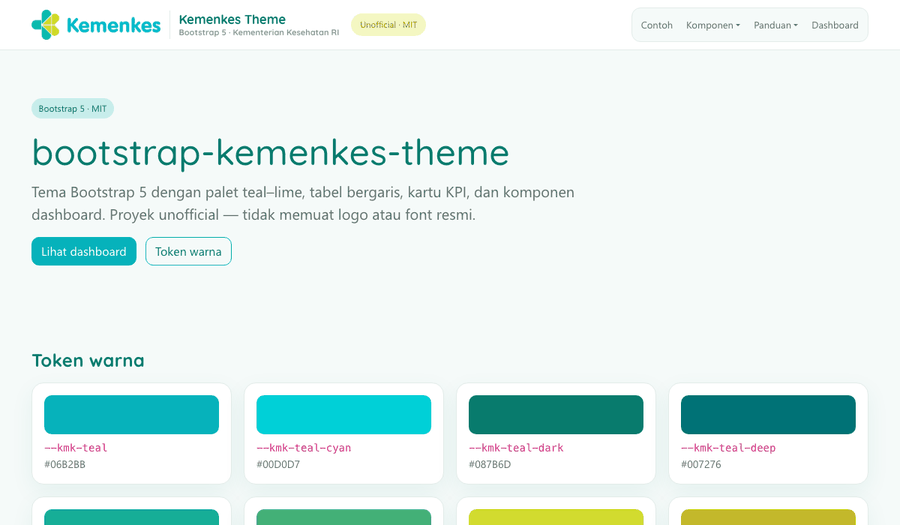
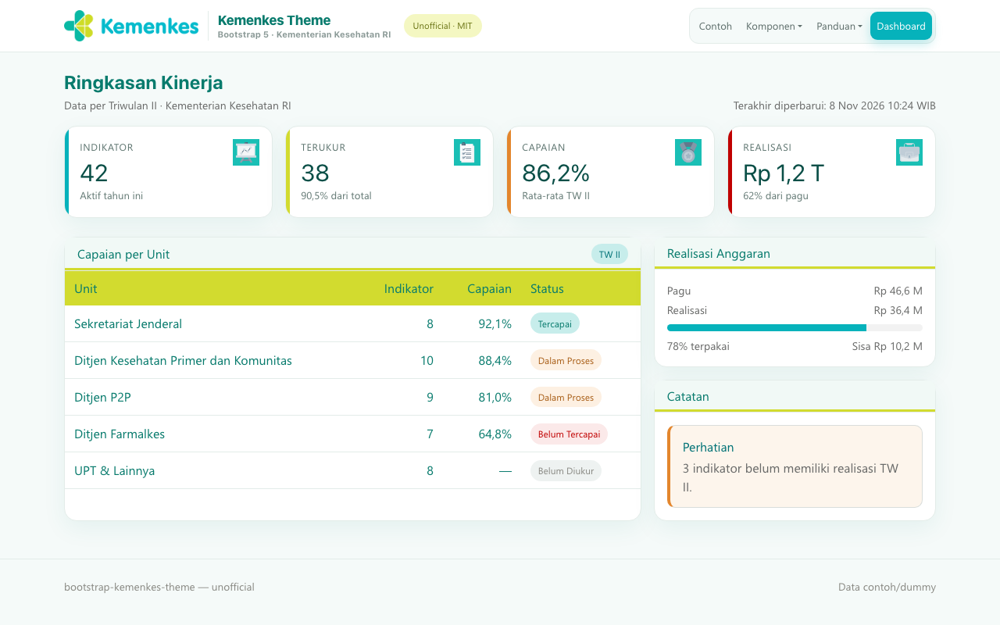
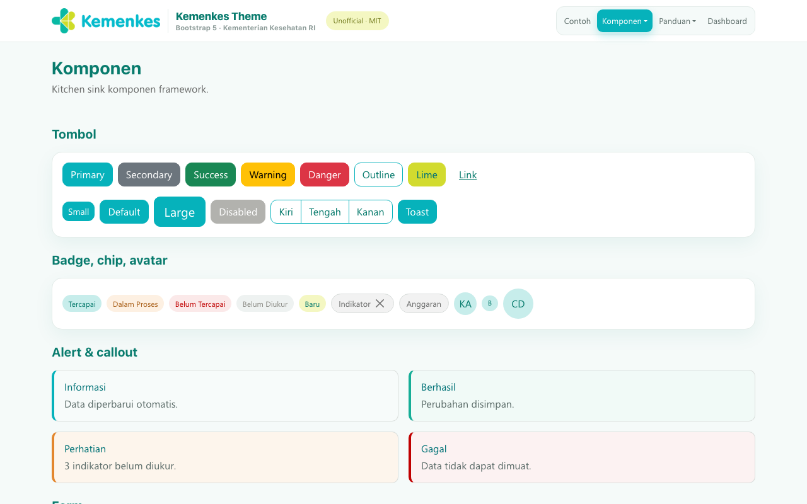
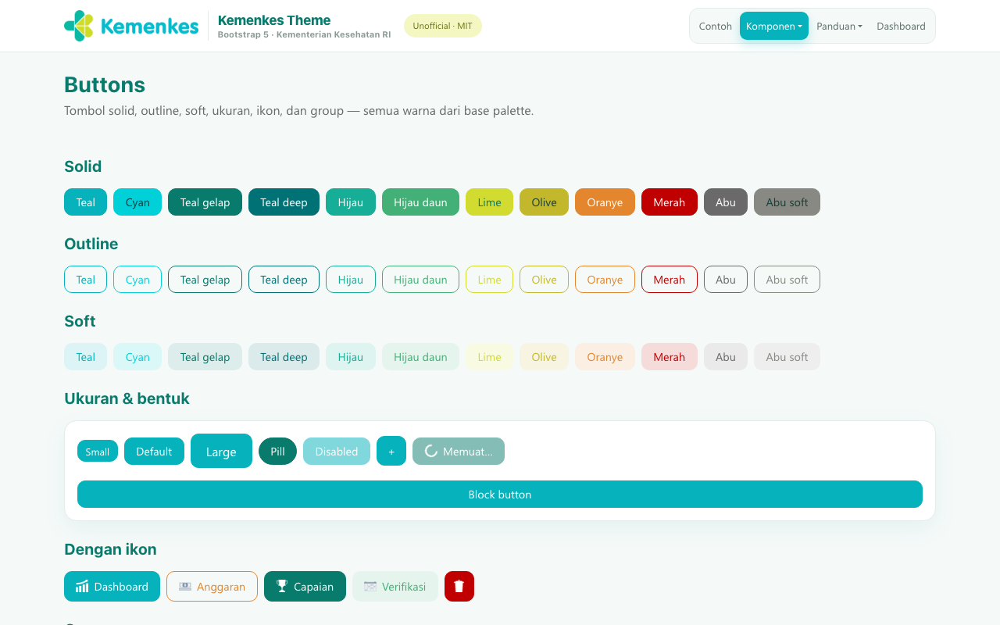
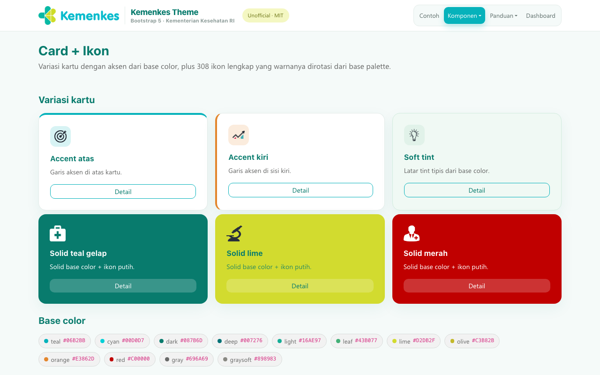
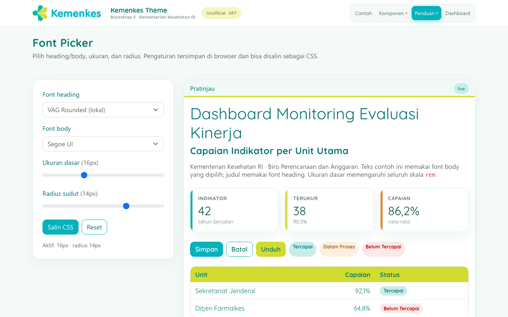
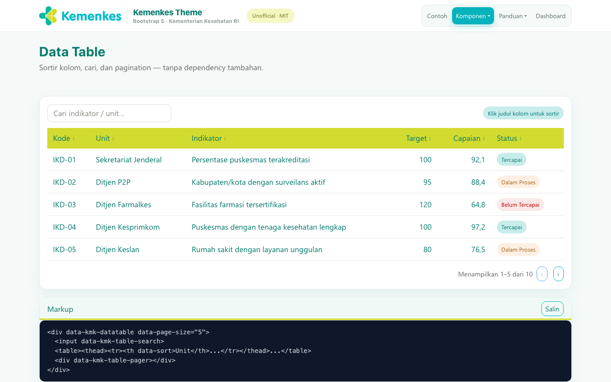
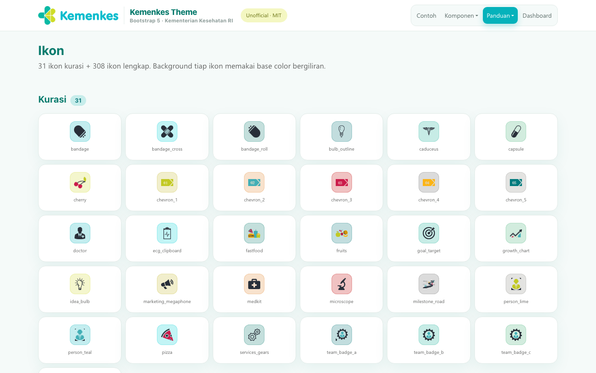
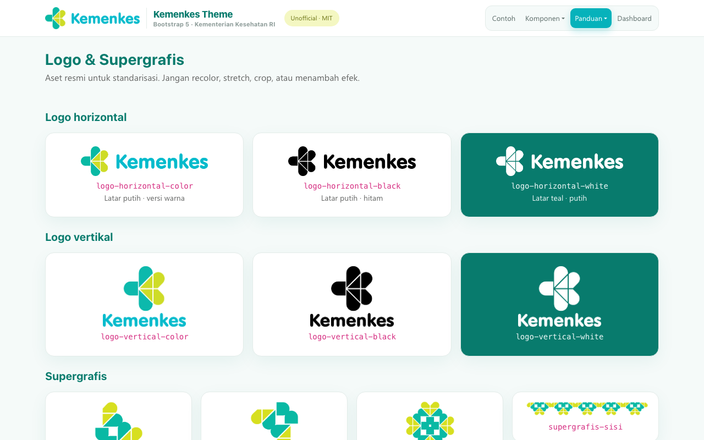

<div align="center">

# Bootstrap Kemenkes Theme

**Tema Bootstrap 5 (unofficial) dengan palet & visual Kemenkes 2024** — siap pakai untuk dashboard, aplikasi internal, dan prototipe.

[](LICENSE)
[](https://getbootstrap.com)
[](CHANGELOG.md)
[](https://etriowidodo.github.io/bootstrap-kemenkes-theme/)
[](#kontribusi)
[](#disclaimer)

[**Live Demo**](https://etriowidodo.github.io/bootstrap-kemenkes-theme/) ·
[**Komponen**](https://etriowidodo.github.io/bootstrap-kemenkes-theme/examples/components.html) ·
[**Dashboard**](https://etriowidodo.github.io/bootstrap-kemenkes-theme/examples/dashboard.html) ·
[**Changelog**](CHANGELOG.md)



</div>

---

## ✨ Fitur

- **Palet resmi Kemenkes 2024** — teal, lime, hijau, oranye, merah, abu (token CSS).
- **Bootstrap 5 override** — cukup load setelah Bootstrap, tanpa build.
- **30 halaman contoh** — patterns, komponen, dashboard, monitoring anggaran.
- **Komponen lengkap** — navbar, sidebar, KPI card, tabel, badge status, callout, form, modal, offcanvas, toast, timeline, skeleton, data table, wizard, chart ringan.
- **Font Picker** — pilih heading/body, ukuran, radius; simpan di localStorage, salin CSS.
- **Card + Ikon** & **Buttons** untuk seluruh base color.
- **Ikon**: 208 ikon default + 31 kurasi + 308 hasil ekstraksi (varian putih).
- **Logo & supergrafis** resmi untuk standarisasi internal.
- **Aksesibilitas**: skip-link, `:focus-visible`, `lang="id"`, tabel responsif.
- **GitHub Pages** siap deploy (workflow disertakan).

## 🚀 Mulai cepat

### Opsi 1 — CDN (tanpa build)

```html
<link href="https://cdn.jsdelivr.net/npm/bootstrap@5.3.3/dist/css/bootstrap.min.css" rel="stylesheet">
<link href="dist/bootstrap-kemenkes.css" rel="stylesheet">
<script src="https://cdn.jsdelivr.net/npm/bootstrap@5.3.3/dist/js/bootstrap.bundle.min.js"></script>
<script src="js/bootstrap-kemenkes.js"></script>
```

### Opsi 2 — Build

```bash
npm install
npm run build     # dist/bootstrap-kemenkes.full.css (Bootstrap + tema)
```

### Contoh pemakaian

```html
<button class="btn btn-primary">Simpan</button>

<div class="kmk-kpi is-lime">
  <div class="kmk-kpi-label">Terukur</div>
  <div class="kmk-kpi-value">38</div>
  <div class="kmk-kpi-sub">90,5% dari total</div>
</div>
```

## 🧩 Halaman & komponen

| Kategori | Halaman |
|---|---|
| **Patterns** | Headers · Heroes · Features · Sidebars |
| **Custom** | Album · Pricing · Checkout · Product · Cover · Carousel · Blog · Sign-in |
| **Framework** | Starter · Jumbotron · Sticky footer · Navbars |
| **Komponen** | Kitchen Sink · Buttons · Card + Ikon · Data Table · Form Wizard · Chart |
| **Panduan** | Font Picker · Logo & Supergrafis · Ikon |
| **Dashboard** | Dashboard · Monitoring Anggaran (clone publik) |

## 📸 Screenshot

| | |
|---|---|
|  |  |
|  |  |
|  |  |
|  |  |

## 🎨 Palet

| Token | HEX | Pemakaian |
|---|---|---|
| `--kmk-teal` | `#06B2BB` | Aksen utama, tombol primary |
| `--kmk-teal-cyan` | `#00D0D7` | Aksen terang |
| `--kmk-teal-dark` | `#087B6D` | Link, heading |
| `--kmk-teal-deep` | `#007276` | Panel/teks tebal |
| `--kmk-teal-light` | `#16AE97` | Success/aksen |
| `--kmk-green-leaf` | `#43B077` | Hijau pendukung |
| `--kmk-lime` | `#D2DB2F` | Header tabel, highlight |
| `--kmk-olive` | `#C3B82B` | Lime gelap |
| `--kmk-lime-soft` | `#F4F7C2` | Latar kartu/callout |
| `--kmk-orange` | `#E3862D` | Peringatan |
| `--kmk-red` | `#C00000` | Error/status kritis |
| `--kmk-gray` | `#696A69` | Body text |
| `--kmk-pale-teal` | `#C7EDEB` | Latar lembut |

## 🔤 Tipografi

- Heading: **VAG Rounded**, fallback Quicksand / system.
- Body: **Segoe UI** / system.
- Font picker tersedia di [`examples/font-picker.html`](examples/font-picker.html).

## 📁 Struktur

```
bootstrap-kemenkes-theme/
├─ dist/                 # override-only + full build
├─ scss/                 # tokens & components (source)
├─ js/                   # helper (font picker, table, wizard, chart, toast)
├─ examples/             # 30 halaman contoh
├─ assets/               # logo, ikon, font
├─ scripts/check-links.mjs
├─ .github/workflows/pages.yml
├─ CHANGELOG.md
├─ LICENSE (MIT)
└─ package.json
```

## 🛠 Scripts

| Perintah | Fungsi |
|---|---|
| `npm run build` | Build `dist/bootstrap-kemenkes.full.css` |
| `npm run check` | Validasi link/aset lokal (30 halaman) |
| `npm run serve` | Jalankan demo lokal |

## 🌐 Deployment

Workflow `.github/workflows/pages.yml` men-deploy ke GitHub Pages pada push ke `main`.
Aktifkan **Settings → Pages → Source: GitHub Actions**. Demo:
`https://etriowidodo.github.io/bootstrap-kemenkes-theme/`

## ⚠️ Disclaimer

Proyek ini **unofficial** dan **tidak berafiliasi/endorsed** oleh Kementerian Kesehatan RI.
Logo, supergrafis, dan font resmi adalah milik pemiliknya dan disertakan untuk keperluan
internal/standarisasi. Untuk repo publik, sesuaikan perizinan aset brand terlebih dahulu.

## 🤝 Kontribusi

Issue & PR terbuka. Mohon tidak mengirim kredensial, data internal, atau aset brand tanpa izin.

## 📄 Lisensi

Kode CSS/HTML/JS: **MIT** — lihat [LICENSE](LICENSE).
Aset brand (logo/supergrafis/font) tidak tercakup lisensi MIT.

<div align="center">

**Kalau repo ini bermanfaat, beri ⭐ agar makin banyak yang menemukannya.**

</div>
